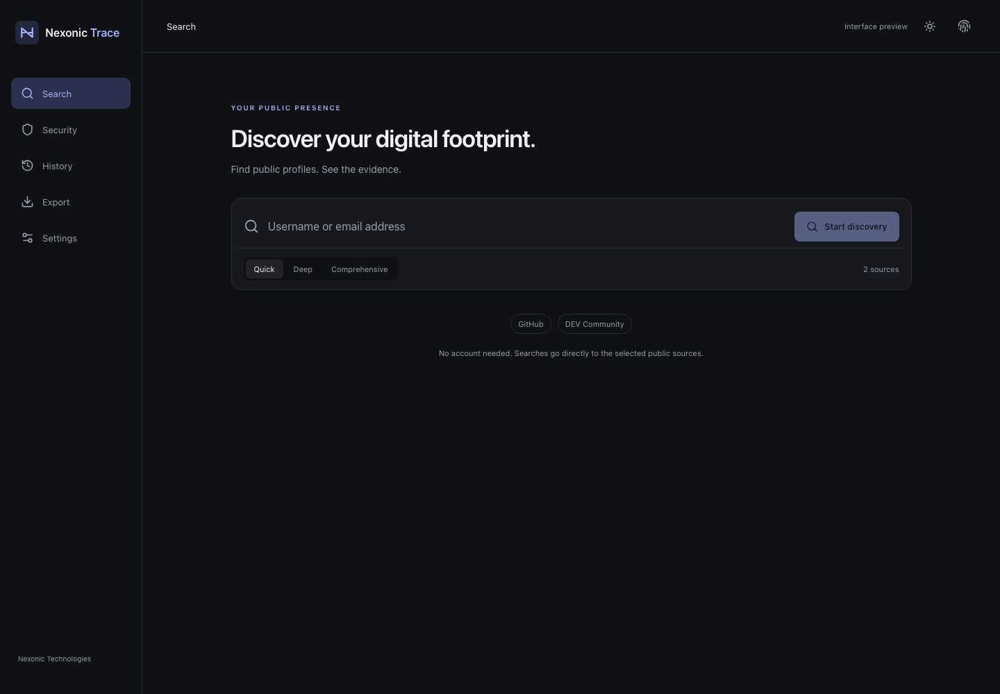
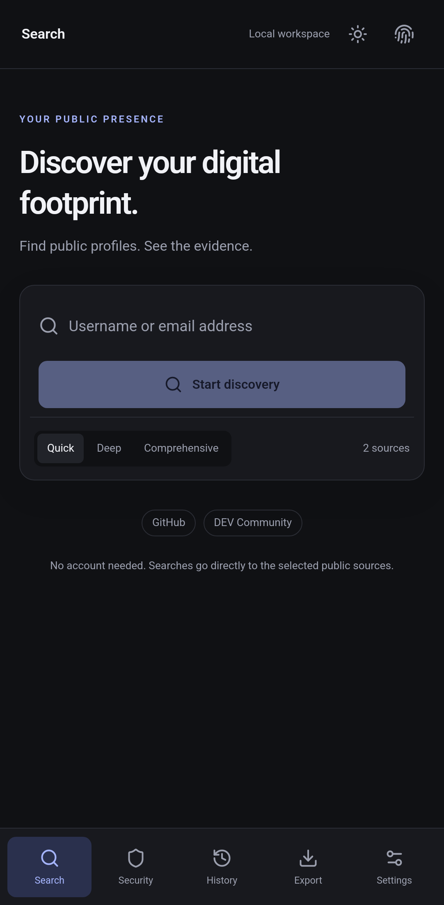
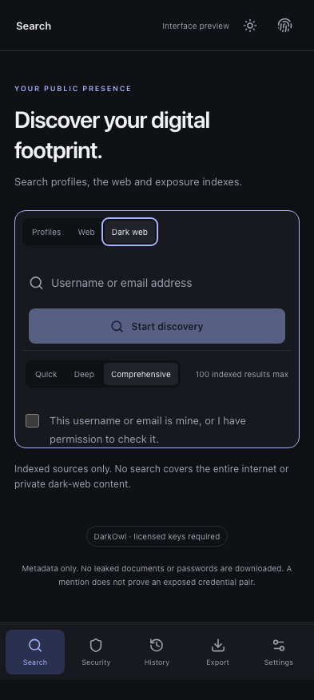

# NEXONIC TRACE

**Discover Your Digital Footprint.**

By Nexonic Technologies

A local-first public-profile discovery and exposure-checking application for Windows, macOS, and Android. Core username searches and password checks need no Nexonic account, hosted backend, subscription, or AI service.



## Features

- Minimal React/TypeScript interface with light/dark themes, compact evidence cards, keyboard controls, and touch navigation.
- 30 official public-API profile sources, including GitHub, GitLab, Mastodon, Bluesky, Lemmy, Wikipedia, Hacker News, Hugging Face, Codeberg, Lichess and Chess.com. Quick/Deep/Comprehensive searches check 10/20/30 sources. See [docs/SOURCE-RESEARCH.md](docs/SOURCE-RESEARCH.md).
- Two-worker concurrency, global and per-domain pacing, timeouts, one controlled transient retry, cancellation, and completed/failed/blocked/skipped outcomes.
- Structured profile verification with positive and negative signals. HTTP 200 alone never confirms an account. Matching usernames never establish shared ownership.
- Optional Brave Search integration for public mentions of usernames or email addresses. Indexed mentions are explicitly unverified and never imply account registration. Quick/Deep/Comprehensive limits are 20/60/100 indexed results across at most 1/3/5 paced pages. Pagination stops when the provider has no further results; duplicates are removed. Partial results survive cancellation or a later-page provider failure. Provider credentials and applicable plan charges are required.
- Visible Profiles / Web / Dark web search areas. Optional licensed DarkOwl discovery accepts usernames and emails, requests only metadata (`detail=nonbody`), and retains only opaque provider record IDs, allowlisted network labels and collection dates. It never fetches leaked documents or snippets and discards all other metadata fields, including unrelated entities and leak download links. Review record IDs in your licensed provider account; these are unverified mentions. A paid account with public/private API keys is required.
- Optional HIBP stealer-log domain metadata for authorized emails requires a Pro plan and provider-verified domain control. No passwords or email/password pairs are requested.
- Optional Have I Been Pwned email-breach lookup with an authorized, licensed API key. Only verified, non-sensitive breach records are shown. The permission checkbox is an authorization statement, not ownership verification; protected records are excluded.
- Free Pwned Passwords checks: explicitly initiated, SHA-1 calculated locally, only five hash-prefix characters sent with padding requested, suffix comparison local. Passwords and complete hashes are never sent to providers, saved, logged, or exported. Sensitive Rust buffers are zeroized where practicable.
- Publicly disclosed names, descriptions, website links, and emails from confirmed profile payloads. Users select sources they independently verified as theirs; the app keeps records separate and makes no identity linkage.
- Opt-in SQLite history, original timestamps, reopening scans, same-query status comparisons, individual deletion, and Delete All Data. No raw pages are retained.
- JSON, CSV, HTML, and PDF report exports with redaction. HTML is escaped and contains no scripts/external resources; CSV neutralizes formula prefixes. PDF preserves unsupported Unicode using explicit code-point notation. Native Save dialogs support platform file destinations.

Provider keys are session-only and cleared when the app closes or data is deleted. They are never written to the local database. Provider plans must permit the user's intended requests, retention, and exports. Nexonic does not set provider prices.

<details>
<summary>Android workspace</summary>



</details>

<details>
<summary>Responsive dark-web search preview</summary>



</details>

## Coverage and limits

The versioned connector registry records allowed HTTPS endpoints, username syntax, detection signals, pacing, timeout, priority, reliability status, and last verification date. Each rule declares the exact fields that prove an account exists and the provider's documented missing-account response. All 30 were verified live on 2026-11-08 against a known account and an impossible username, and those captured responses are regression tests. This shows the rules match the providers today; it is not a guarantee of identity ownership. Rule changes ship with tested application updates; arbitrary remote rules are not loaded.

Only permitted public APIs and explicitly selected licensed indexes are queried. The app does not search the entire internet, bypass login/CAPTCHA/rate limits, or use signup, password-reset, or recovery flows. Licensed DarkOwl coverage includes its collected darknet and adjacent sources, not every Tor/I2P service or private community. No result means only that the selected index returned no match. Email breach records, dark-web mentions and password prevalence remain separate; the app does not verify or expose a working credential pair. Searches disclose the supplied query to each selected source or optional provider. No analytics or Nexonic server upload is enabled.

Browser preview does not execute live searches or security checks. Native interaction, platform packaging, signing, and credentialed-provider acceptance must be assessed separately from browser tests. Production readiness is not claimed.

## Develop

Use Node.js 24 LTS, a current stable Rust toolchain, and [Tauri platform prerequisites](https://v2.tauri.app/start/prerequisites/). Windows requires Microsoft C++ Build Tools and WebView2; macOS requires Xcode Command Line Tools. Android needs the SDK, NDK, JDK, and Rust Android targets.

```sh
npm ci
npm run tauri dev
```

Interface-only preview: `npm run dev`.

```sh
npm run check
npx playwright install chromium
npm run test:ui
npm run build
cargo fmt --all --check
cargo test --workspace --locked
cargo clippy --workspace --all-targets --locked -- -D warnings
```

Explicit live smoke probes, using public test queries and official HIBP fixtures only:

```sh
cargo run -p trace-core --example probe -- thibault comprehensive
cargo run -p trace-core --example security_probe
```

The security probe uses a publicly documented integration-test key, not a real credential. Integration-test addresses are excluded from the application exposure UI.

## Local data and Windows portable mode

History is off by default. Normal application data uses the operating system's per-user application directory. To use Windows portable mode, place `portable.txt` beside the executable in a writable directory. Ordinary preferences and optional SQLite history then use `NexonicTraceData` beside the application. Provider keys remain session-only. WebView2 is an operating system runtime prerequisite; portability does not remove that requirement.

Delete All Data removes saved scans, ordinary preferences, in-memory provider keys, and current session results. Optional history contains public personal information; choose a private folder and use redaction before sharing reports.

## Distribution

Development build status is recorded in [progress](docs/PROGRESS.md), with [packaging gates](docs/PACKAGING.md) and [dependency audit scope](docs/SECURITY-AUDIT.md). Validated test downloads appear in [GitHub Releases](https://github.com/Shahrukhalid/Nexonic-Trace/releases). The permanent Android identity is held in a protected signing environment. Trusted Windows/Apple signing accounts remain required; see [production signing](docs/PRODUCTION-SIGNING.md). Private material is never committed. Development artifacts must be clearly labeled; no signing or production-readiness claims are made without successful verification. Linux and iOS applications are outside scope.

Original code: [MIT](LICENSE). See [third-party notices](THIRD_PARTY_NOTICES.md), [contributing](CONTRIBUTING.md), and [security policy](SECURITY.md).
